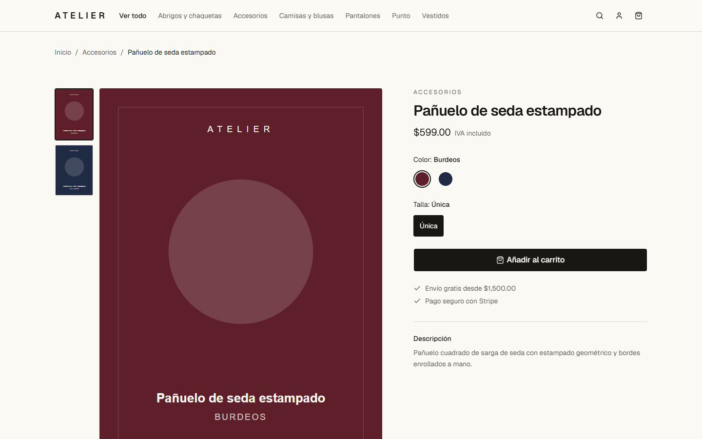
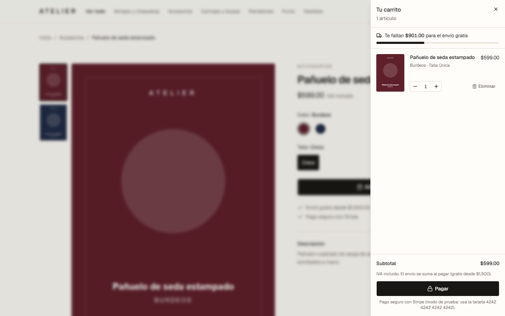
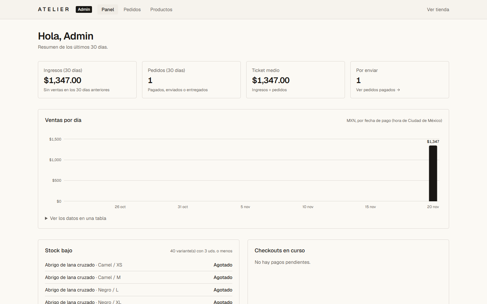
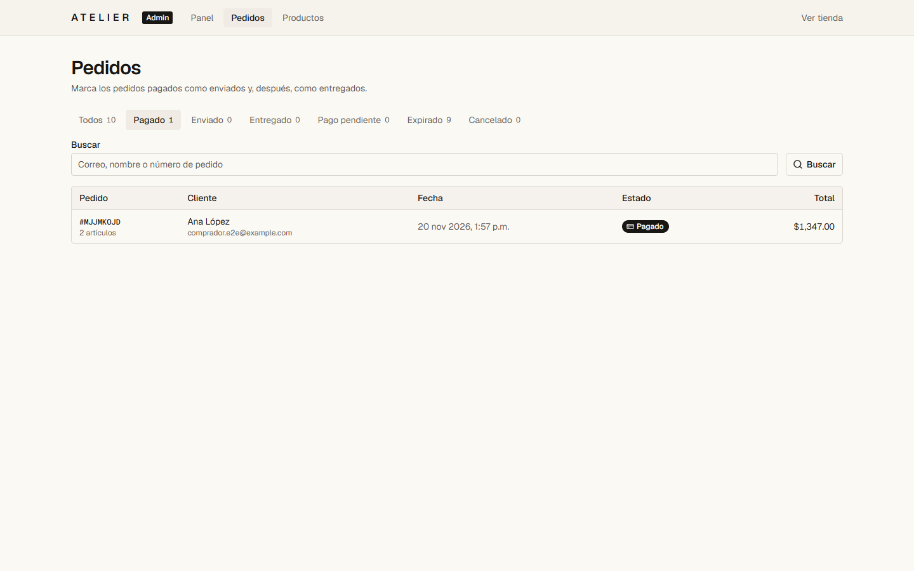
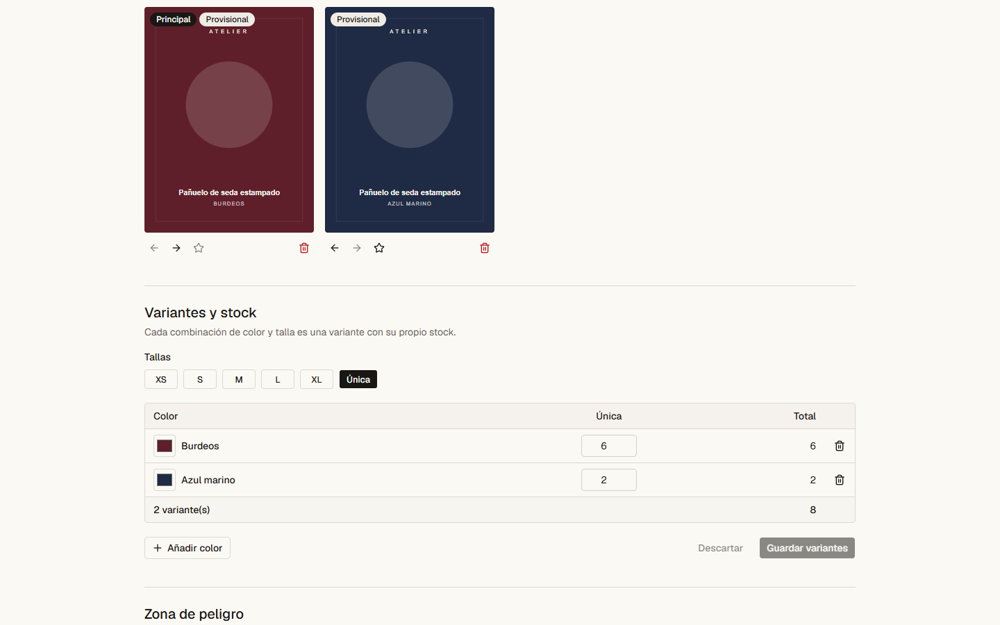
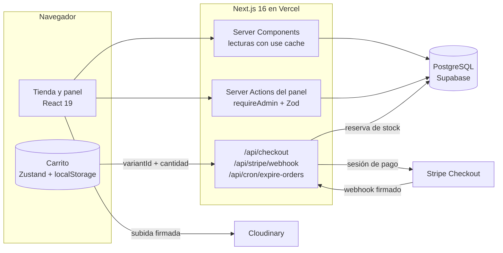
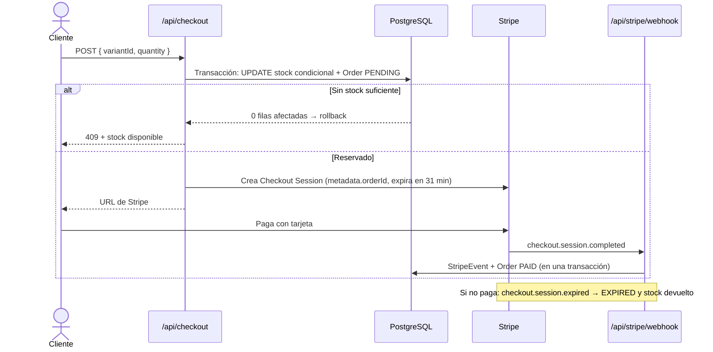
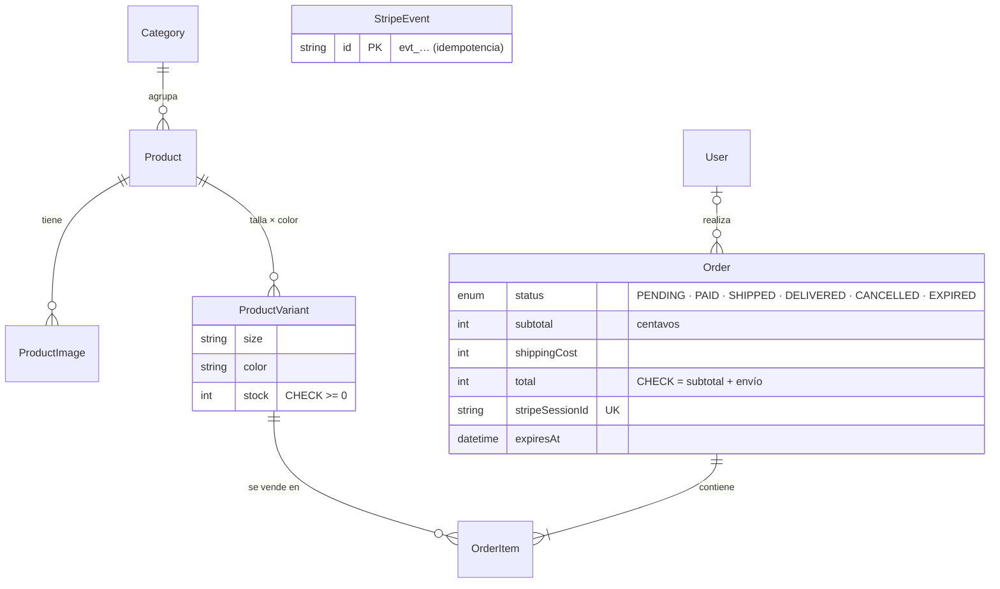

# ATELIER

Tienda de moda contemporánea, de punta a punta: catálogo con filtros, carrito, pago con Stripe, panel de administración con subida de fotos a Cloudinary, gestión de pedidos y métricas de ventas.

El reto técnico central es **no vender nunca más unidades de las que hay**, aunque varias personas compren la última unidad a la vez. Está resuelto con una reserva de stock atómica en PostgreSQL y lo demuestra un test con 20 compras simultáneas.

**Demo:** _pendiente de despliegue_ · **Pago de prueba:** tarjeta `4242 4242 4242 4242`, cualquier fecha futura y cualquier CVC (Stripe en modo test: no se cobra nada).


| Catálogo con filtros                       | Ficha de producto                                   | Carrito                                  |
| ------------------------------------------ | --------------------------------------------------- | ---------------------------------------- |
|  |  |  |

| Panel: métricas                                    | Panel: pedidos                                 | Panel: variantes y stock                                   |
| -------------------------------------------------- | ---------------------------------------------- | ---------------------------------------------------------- |
|  |  |  |

## Qué incluye

**Tienda**

- Catálogo con filtros por categoría, color, talla y precio guardados en la URL (enlaces compartibles), búsqueda predictiva y paginación.
- Ficha de producto con galería, zoom y selector de variantes dependiente: al elegir un color solo se habilitan las tallas con stock.
- Carrito persistente con barra de envío gratis (desde $1,500 MXN).
- Pago con Stripe Checkout, página de confirmación que espera al webhook y vacía el carrito.
- Cuentas con correo y contraseña o Google, e historial de pedidos con su estado de envío.

**Panel de administración** (rol `admin`)

- Productos: alta, edición y borrado; fotos con arrastrar y soltar subidas directamente a Cloudinary; matriz de variantes talla × color con su stock.
- Pedidos: filtros por estado, búsqueda, detalle y avance del envío (Pagado → Enviado → Entregado).
- Métricas: ingresos de 30 días frente al periodo anterior, ticket medio, pedidos por enviar, stock bajo y gráfica de ventas diarias accesible con teclado.

## Stack

Next.js 16 (App Router, Cache Components) · React 19 · TypeScript estricto · Tailwind CSS 4 + shadcn/ui · Better Auth · Prisma 7 + PostgreSQL (Supabase) · Stripe Checkout · Cloudinary · Zustand · Zod · Vitest.

## Decisiones técnicas

### Cómo se evita vender de más

El stock se **reserva al crear el checkout**, no al recibir el pago. Para cada línea del carrito se ejecuta, dentro de una sola transacción:

```sql
UPDATE "ProductVariant" SET stock = stock - $cantidad
WHERE id = $variante AND stock >= $cantidad
```

PostgreSQL bloquea la fila y vuelve a evaluar el `WHERE` tras el bloqueo. Si dos compras piden la última unidad, solo una afecta a una fila; la otra afecta a cero, la transacción entera se deshace y la API responde `409` con el stock que queda (el carrito se ajusta solo). Las variantes se bloquean siempre en el mismo orden (por id) para que dos carritos con las mismas prendas no se interbloqueen. Además, un `CHECK (stock >= 0)` en la tabla es una segunda red: aunque el código fallara, la base de datos rechazaría un stock negativo.

**Por qué reservar antes del pago:** si el stock solo se descontara al pagar, dos clientes podrían estar en la página de Stripe por la misma última unidad y ambos pagarían. Reservar primero convierte ese caso en un `409` inmediato y claro, a cambio de retener unidades mientras alguien paga. Esa retención caduca: la sesión de Stripe dura 31 minutos.

**Test:** variante con stock 1 y 20 peticiones simultáneas a `/api/checkout` contra PostgreSQL real → 1 éxito, 19 × `409`, stock final 0. Se comprobó que el test **falla** si se quita la condición `stock >= cantidad`.

### El servidor ignora los precios del cliente

El carrito vive en el navegador y guarda precios solo para mostrarlos. `/api/checkout` recibe únicamente `{ variantId, quantity }`; cualquier otro campo se descarta. Precios, envío y total se leen de la base de datos y son los que se envían a Stripe. Todo el dinero se maneja en **centavos enteros**, nunca con decimales.

### Webhook idempotente

Una orden pasa a `PAID` **solo desde el webhook de Stripe** y solo si `payment_status === "paid"`; nunca desde la página de éxito. El webhook:

1. lee el cuerpo sin parsear y verifica la firma de Stripe;
2. inserta el `event.id` en la tabla `StripeEvent` **en la misma transacción** que sus efectos (`INSERT … ON CONFLICT DO NOTHING`). Si el evento ya estaba, no hace nada; si el proceso falla, tampoco queda registrado y Stripe lo reintenta;
3. aplica las transiciones con escrituras condicionales (`WHERE status = 'PENDING'`), así que el stock se devuelve una sola vez aunque el webhook y el cron coincidan.

Probado con el mismo evento entregado dos veces y con cinco entregas simultáneas: una se procesa y el resto se ignora.

### Liberación del stock de pagos abandonados

- **Principal:** el webhook `checkout.session.expired` marca la orden `EXPIRED` y devuelve el stock.
- **Respaldo:** un cron (`/api/cron/expire-orders`, protegido con `CRON_SECRET`) revisa órdenes vencidas. Antes de liberar nada **expira la sesión en Stripe**, para que nadie pueda pagar una orden cuyo stock ya se devolvió; si descubre que la sesión sí se pagó y el webhook se perdió, la marca como pagada.

### Otras decisiones

- **Permisos en dos capas.** El proxy solo redirige rápido a quien no tiene sesión. La verificación real del rol `admin` está dentro de cada Server Action, Route Handler y página del panel; un test comprueba que ninguna acción de admin llega a ejecutarse sin el rol.
- **Subida de fotos firmada.** El servidor firma la subida limitada a la carpeta del producto y a formatos raster; el navegador sube directo a Cloudinary sin pasar por la función serverless. Después el servidor verifica la firma de la respuesta de Cloudinary y construye la URL él mismo: nunca guarda una URL que mande el cliente.
- **Edición de stock sin pisar ventas.** El admin edita el stock con escritura condicional sobre el valor que vio: si una venta reservó unidades mientras editaba, se muestra un conflicto en lugar de sobrescribirlas.
- **Caché.** Las lecturas del catálogo usan `"use cache"` con etiquetas; el admin las invalida al instante (`updateTag`) y el checkout y el webhook al cambiar stock (`revalidateTag`).

## Arquitectura



**Flujo de pago**



**Modelo de datos**



## Calidad

| Página (build de producción) | Rendimiento móvil | Rendimiento escritorio | Accesibilidad | Buenas prácticas | SEO |
| ---------------------------- | :---------------: | :--------------------: | :-----------: | :--------------: | :-: |
| Inicio                       |        93         |          100           |      100      |       100        | 100 |
| Catálogo                     |        91         |          100           |      100      |       100        | 92* |
| Ficha de producto            |        92         |          100           |      100      |       100        | 100 |

Lighthouse 13, mediana de 5 ejecuciones en móvil. \*En el catálogo los metadatos dependen de la URL y Next 16 los envía en streaming a los navegadores; los rastreadores que no ejecutan JavaScript (Bing, redes sociales) los reciben en el `<head>`.

- **Tests:** 219 unitarios y de componentes (Vitest) y 17 de integración contra PostgreSQL real en Docker: concurrencia de stock, webhook duplicado y concurrente, expiración y cron.
- **Accesibilidad:** auditoría con axe-core (WCAG 2.1 AA) de 36 páginas y estados, incluido el panel, en escritorio y móvil: 0 infracciones. Navegación completa con teclado, foco visible y devuelto al cerrar diálogos, y estados nunca indicados solo con color.
- **Rendimiento:** el JavaScript inicial se redujo al sacar Zod del cliente y cargar los diálogos (búsqueda, menú, carrito) bajo demanda; las imágenes candidatas a LCP se piden con prioridad alta. Se probó `inlineCss` y se descartó porque empeoraba el primer pintado.
- **SEO:** metadatos y Open Graph por página, datos estructurados `Product` y `WebSite`, `sitemap.xml`, `robots.txt`, y `noindex` en búsquedas y combinaciones de filtros.

## Credenciales de prueba

| Rol     | Correo                   | Contraseña               |
| ------- | ------------------------ | ------------------------ |
| Cliente | _se publica con la demo_ | _se publica con la demo_ |
| Admin   | _se publica con la demo_ | _se publica con la demo_ |

Tarjetas de Stripe en modo test: `4242 4242 4242 4242` (pago correcto), `4000 0000 0000 0002` (rechazada), `4000 0025 0000 3155` (pide 3D Secure).

## Ejecutarlo en local

Requisitos: Node.js 24 o superior, pnpm, una base de datos PostgreSQL (por ejemplo, un proyecto gratuito de Supabase), cuentas de Stripe (modo test) y Cloudinary, [Stripe CLI](https://docs.stripe.com/stripe-cli) y Docker para los tests de integración.

```bash
pnpm install
cp .env.example .env        # rellena los valores; cada variable está explicada en el archivo
pnpm db:deploy              # aplica las migraciones (usa DIRECT_URL)
pnpm db:seed                # 6 categorías, 16 productos con variantes y el usuario admin
pnpm dev                    # http://localhost:3000
```

Para que los pagos lleguen a `PAID` en local, reenvía los webhooks de Stripe y copia el `whsec_…` que imprime en `STRIPE_WEBHOOK_SECRET`:

```bash
stripe listen --forward-to localhost:3000/api/stripe/webhook
# Si tu clave es de un sandbox de Stripe, añade --api-key <tu sk_test_…>:
# sin ella, la CLI escucha la cuenta con la que hiciste `stripe login`.
```

Comprobaciones:

```bash
pnpm lint && pnpm typecheck && pnpm test   # estática y unitarios
pnpm db:test:up && pnpm test:integration   # PostgreSQL desechable en Docker (puerto 54329)
pnpm db:test:down
```

Los tests de integración se niegan a ejecutarse si la base de datos no es local, porque vacían las tablas.

## Despliegue en Vercel

1. Importa el repositorio en Vercel (detecta Next.js y usa `pnpm build`).
2. Configura las variables de entorno de `.env.example`, con estas diferencias respecto a local:
   - `NEXT_PUBLIC_APP_URL` y `BETTER_AUTH_URL`: la URL pública del despliegue.
   - `DATABASE_URL`: el pooler de Supabase en modo transacción (puerto 6543).
   - `STRIPE_WEBHOOK_SECRET`: el secreto del endpoint que crees en el paso 4, no el de `stripe listen`.
   - `CRON_SECRET`: una cadena aleatoria larga (Vercel la envía en el encabezado `Authorization` del cron).
3. Aplica las migraciones a la base de datos de producción: `pnpm db:deploy` con `DIRECT_URL` apuntando a ella.
4. En Stripe (modo test), crea un endpoint de webhook a `https://<tu-dominio>/api/stripe/webhook` con los eventos `checkout.session.completed`, `checkout.session.expired`, `checkout.session.async_payment_succeeded` y `checkout.session.async_payment_failed`.
5. En Google Cloud, añade `https://<tu-dominio>/api/auth/callback/google` como URI de redirección autorizada.

El cron está definido en `vercel.json` cada 15 minutos. El plan Hobby de Vercel solo permite crons diarios; no es un problema porque el webhook de expiración es el mecanismo principal y el cron solo es el respaldo.

## Documentación del proyecto

- [ATELIER.md](ATELIER.md): especificación completa (módulos, modelo de datos, flujo de pago, seguridad).
- [TODO.md](TODO.md): plan por fases y decisiones abiertas.
